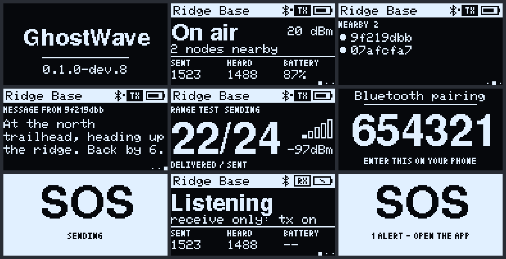

# RAK3401 + RAK13302 (1 W): flashing and first test

For the WisMesh High Power Booster kit: RAK3401 core, RAK13302 module (SX1262 + SKY66122 amplifier).
It is built from `firmware/mcu`, env `rak3401_1w`. **Do not use the RAK4631 file**: the radio is on
different pins.

> **Untested on hardware.** It compiles. Pins and amplifier gain come from Meshtastic's RAK3401 1 W
> variant and RAK's RAK13302 datasheet. Nobody has run this build on a board.

## Before you start

- **Antenna first, every time.** Never power this board without the LoRa antenna attached.
- **Battery:** RAK says the module needs the base board's battery or an external 5 V supply. Peak draw
  at full output is about 1 A at 5 V, so test on battery.
- **Power:** the default is 10 dBm at the antenna port. `power <dBm>`, or the app's Node settings,
  goes up to **29 dBm** (about 0.8 W): the owner chose to lift the general 22 dBm cap on this 1 W
  board. 29 is the most Meshtastic's RAK13302 gain table reaches (drive 20–21 + 8–9 dB). Staying
  within the limit where you operate, antenna gain included, is up to you (DESIGN §12). The firmware
  subtracts the amplifier's gain, and its lowest setting is about 7 dBm.
- **Bluetooth pairing key:** `654321` unless changed with `ble pin <6 digits>` on the console.
- **Transmit is off at first,** until `tx on` on the serial console at 115200.
- **Display:** a RAK1921 OLED cycles status, neighbors and the latest message every 5 s, with Bluetooth,
  TX/RX and battery in the top bar. It shows the Bluetooth passkey while pairing. It dims after a minute and
  turns off after ten, and a message, SOS, pairing or a phone connecting wakes it (so does `display` on the
  console). The battery reading is uncalibrated.
- **Bootloader:** this build expects S140 6.1.1 and an application start of 0x26000.

## Screen

Rendered on a computer by `firmware/mcu/tools/oled_preview/preview.sh`, from the same drawing code the board runs.

## Flash

1. Attach the antenna and connect the battery.
2. Double-tap reset. A UF2 drive appears.
3. Open `INFO_UF2.TXT`. It must say `SoftDevice: S140 6.1.1`. If it shows another SoftDevice, stop.
4. Drag the `ghostwave-rak3401_1w-*.uf2` file onto the drive.

## First test

Open the serial console at 115200 and type `status`. Radio init must say ok. If it prints
`radio init failed`, copy that number. Pair with the app, then type `tx on` only when the antenna is on.

## Status LEDs

The green LED blinks briefly every 5 seconds while GhostWave runs and flashes once a second during an SOS. The blue LED stays on while a phone is connected. There is no user button.
